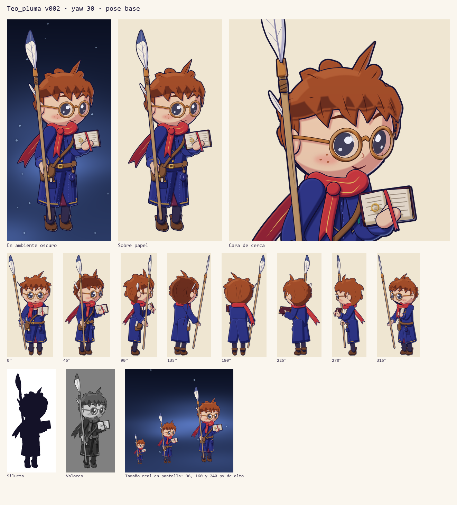
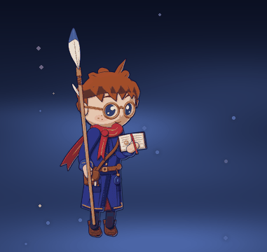
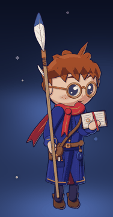
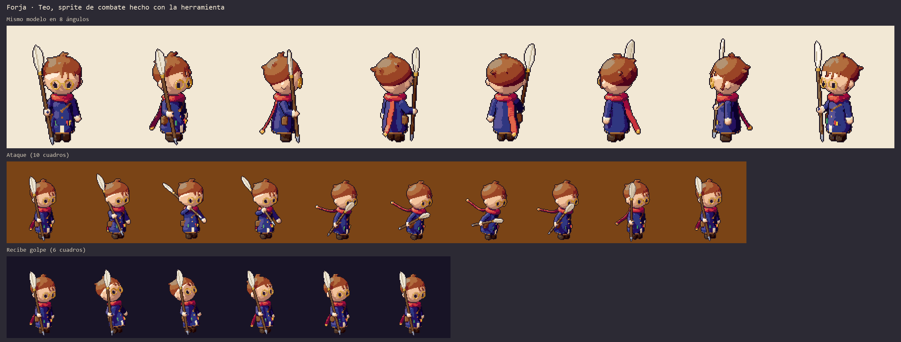
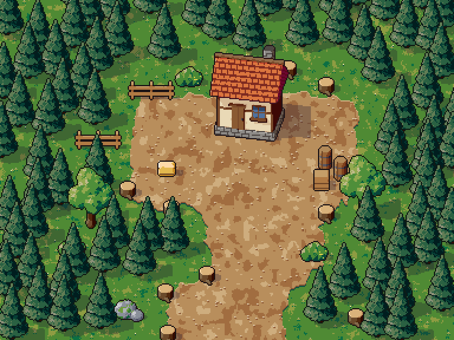
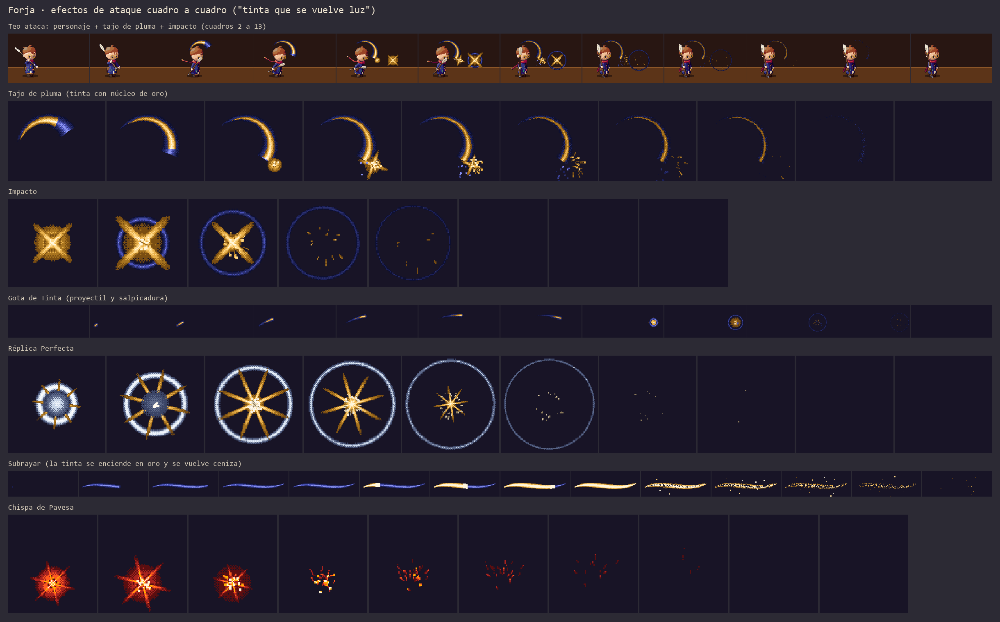
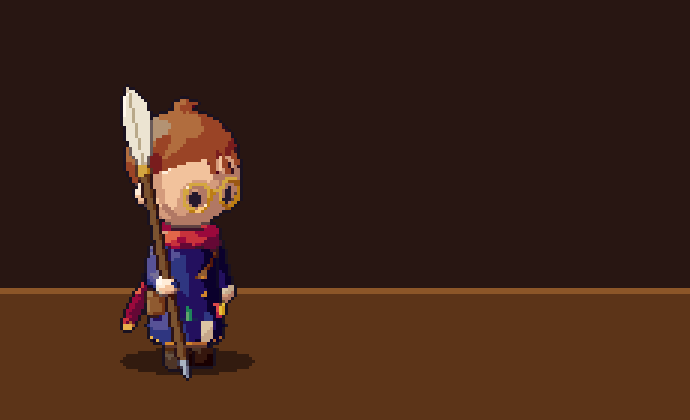

# Forja: herramienta de arte

Forja es la herramienta con la que Claude dibuja, revisa y anima el arte de *El Bibliotecario*. No usa modelos que generan imágenes. Cada personaje, edificio o efecto se escribe como un archivo de texto con piezas, colores y huesos, y un motor en Python lo dibuja. Tiene dos estilos:

- **Ilustrado (pluma):** tinta y color plano en alta resolución, con líneas suaves y sombras dibujadas, inspirado en juegos dibujados a mano como Hollow Knight. Es la dirección actual para los personajes.
- **Pixel art:** el primer estilo, que se mantiene para el mundo y los efectos mientras se decide.

En los dos:

- el mismo personaje sale idéntico desde cualquier ángulo y en cada cuadro de animación;
- cualquier parte se puede cambiar (el sombrero, un color, la pose) sin redibujar el resto;
- cada render pasa por una revisión automática que señala pixeles sueltos, huecos en el contorno, curvas con dientes, bandas de sombra y colores que no se distinguen.

## Estilo ilustrado (pluma)



 

Las piezas son formas con volumen pegadas a un esqueleto 3D, pero en cada cuadro se proyectan a la pantalla como curvas exactas y se pintan como lo haría un ilustrador:

1. **Tinta.** Contorno más grueso del lado contrario a la luz y una línea todavía más gruesa alrededor de toda la silueta.
2. **Color plano** por material, con su tono de sombra, de luz y de línea.
3. **Lo pegado a cada pieza** (bolsillos, botones, solapas, manchas de tinta), recortado a su forma.
4. **Sombra en media luna** y **sombras que proyectan las piezas de adelante**, en una capa multiplicada que también oscurece los detalles.
5. **Luces, brillos y trazos interiores**: pliegues, mechones y costuras punteadas.
6. **Calcas sobre la cara**: ojos, cejas, boca, pecas y mejillas se dibujan de frente y se pegan a la cabeza. Al girar se deforman y se recortan justo en el borde de la silueta.
7. **Expresiones**: cada calca dice en qué caras aparece (`normal`, `parpadeo`, `decidido`, `grito`, `dolor`). Las animaciones eligen la cara por clave o por tramo.

| Forma | Para qué sirve |
|---|---|
| `elipsoide` | Cabeza, nariz, orejas, nudos; recibe calcas |
| `tubo` | Brazos, piernas, bufanda, báculo; cada punto puede ir pegado a otro hueso y tener su radio |
| `casco` | Torso, faldón, manos, botas: la envolvente de varias esferas (y discos) |
| `caja`, `cilindro` | Morral, puños, virolas, vueltas de bota |
| `lamina` | Piezas planas con agujeros: lentes, páginas, plumas, bolsillos, solapas |
| `cinta` | Listones que se tuercen y muestran su revés, con punta en V |
| `mechones` | Pelo: mechones afilados que nacen sobre la cabeza y la siguen o salen de ella |

Otras herramientas del estilo:

- `dentro_de: pieza` recorta un detalle a la forma de otra pieza.
- `apunta: [x, y, z]` en un hueso (o en una clave de animación) orienta el báculo o el libro hacia una dirección. En las animaciones, la dirección sigue un arco y el giro de la muñeca se calcula en cada cuadro.
- Los mechones que nacen del lado oculto de la cabeza se dibujan detrás de ella, desde cualquier ángulo.
- `python -m forja texto modelo.yaml --zona x,y` dice qué pieza hay en ese pixel, para encontrar qué tapa qué.

```bash
python -m forja hoja personajes/teo_pluma.yaml
python -m forja animar personajes/teo_pluma.yaml --anim ataque
```

## Estilo pixel art









## Cómo funciona

1. **Modelo.** Cada pieza es una forma con volumen (esfera, elipsoide, cápsula, caja, cilindro, cono, toro o polígono extruido), pegada a un hueso. Las piezas de un mismo grupo se funden suavemente.
2. **Render.** El motor traza un rayo por cada pixel del tamaño final, sin suavizado. Calcula la luz por pasos de una rampa de color con giro de tono (las sombras se enfrían y las luces se calientan), oclusión, sombras proyectadas y brillos.
3. **Limpieza.** Quita pixeles sueltos y escaleras de un pixel, y une grupos de 1 o 2 pixeles al tono que los rodea.
4. **Líneas.** Dibuja un contorno exterior de 1 px y líneas interiores entre piezas que se tapan, con el color de la pieza de adelante.
5. **Calcas y retoques.** Detalles pintados a mano (boca, pecas) que cambian según el ángulo, y correcciones de pixel por cuadro.
6. **Revisión.** Una hoja con la vista ampliada y las marcas de los problemas, el sprite sobre varios fondos, la silueta, el mapa de valores, las piezas y los pasos de luz.

## Uso

Requiere Python 3.12 con `numpy`, `Pillow` y `PyYAML`, más `skia-python` para el estilo ilustrado (`pip install skia-python`). Desde `herramientas/forja/`:

```bash
python -m forja hoja personajes/teo.yaml
```

| Orden | Para qué sirve |
|---|---|
| `hoja modelo.yaml [--yaw --pitch --anim --cuadro --ref imagen]` | Render con hoja de revisión e informe de problemas |
| `giro modelo.yaml [--yaws 0,45,90,...]` | El modelo desde varios ángulos (con negativos: `--yaws=-12,30`) |
| `animar modelo.yaml --anim nombre` | Tira de cuadros, papel cebolla, GIF y control de parpadeo |
| `texto modelo.yaml [--zona x0,y0,x1,y1]` | El sprite como letras, para leer y corregir pixeles exactos |
| `paleta modelo.yaml` | Las rampas de color de todos los materiales |
| `escena escena.yaml` | Compone un escenario: suelo, objetos, bosque repartido y sombras |
| `efecto efecto.yaml` | Un efecto de combate cuadro a cuadro, más su máscara de brillo |

A los archivos que son bibliotecas de objetos se les agrega `--objeto nombre`. Cada corrida queda en `salida/<modelo>/` con número de versión y una copia del archivo usado, para comparar contra versiones anteriores.

## Qué contiene

| Carpeta | Contenido |
|---|---|
| `forja/` | El motor: `pluma` y `laminas` (estilo ilustrado), `modelo`, `render`, `sdf` (formas), `color` (rampas en OKLab), `revisar`, `vistas`, `baldosas`, `escena`, `efectos` |
| `personajes/` | Teo ilustrado (`teo_pluma.yaml`: El Cuento en una mano, la Pluma de Aprendiz en la otra, cinco expresiones, reposo, ataque y golpe) y Teo en pixel art (`teo.yaml`) |
| `mundo/` | Casa, pino, roble, biblioteca de objetos (barril, caja, rocas, tocón, cerca, arbusto, heno) y la escena de la aldea |
| `efectos/` | Tajo de pluma, impacto, Gota de Tinta, Réplica Perfecta, Subrayar y chispa de Pavesa |
| `muestras/` | Imágenes de ejemplo |

## Cámaras

- **Combate:** ortográfica con giro (`yaw`) e inclinación (`pitch`). Teo usa yaw 35 y pitch 12.
- **Mundo:** oblicua (`proyeccion: oblicua`). El suelo se ve desde arriba sin deformar y los objetos casi de frente (`alto: 1.0`, `fondo: 0.55`), como en los juegos de aldea cenitales.

## Formato del modelo (resumen)

```yaml
nombre: Teo
lienzo: [112, 124]          # tamaño del sprite
origen: [56, 116]           # pixel donde cae el punto entre los pies
camara: {yaw: 35, pitch: 12}
materiales:
  abrigo: {color: '#2f3680'}               # rampa de 5 tonos generada
  ojo: {colores: [...], plano: true, brillo: 0.3}
huesos:
  - {nombre: hombro, padre: torso, pos: [11, 15, 0], espejo: true}   # crea hombro.i y hombro.d
piezas:
  - {nombre: manga, hueso: hombro, forma: capsula, a: [0, 1, 0], b: [0, -8, 0], ra: 3.4, rb: 3, material: abrigo}
    # regiones: franja, caja, esfera, semiespacio, cuadros, rayas, ladrillos, ruido
    # rugosidad: {escala, fuerza} para follaje y rocas
pose_base: {codo.d: [-60, 0, 0]}
animaciones:
  reposo: {cuadros: 8, pose: {torso: {pos: [0, 'floor(0.5 + 0.9*sin(tau*t))', 0]}}}
  ataque: {cuadros: 10, bucle: false, claves: [{t: 0, pose: {}}, {t: 0.3, pose: {...}}]}
```

## Límites actuales

- Estilo ilustrado: solo Teo está hecho. El mundo y los efectos siguen en pixel art hasta decidir si también pasan a este estilo.

- El acabado todavía no iguala a un pixel artista profesional en caras y telas. Para eso están las calcas y los retoques de pixel, que hay que ir afinando a mano.
- Los efectos son la forma en pixel. El resplandor se agrega en el motor del juego usando la máscara de brillo que exporta cada efecto.
- Las baldosas exportables por esquinas (`juego_de_esquinas`) existen, pero todavía no hay exportación directa a Godot.
